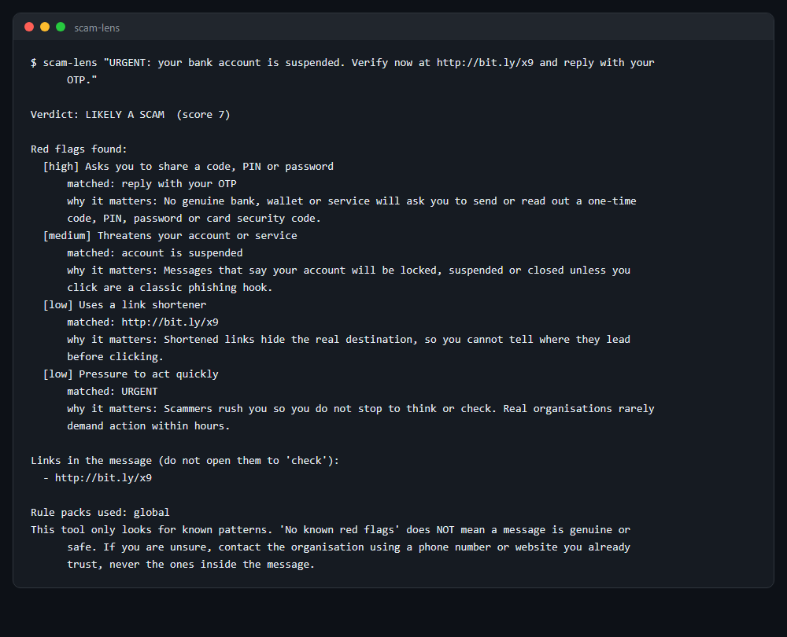
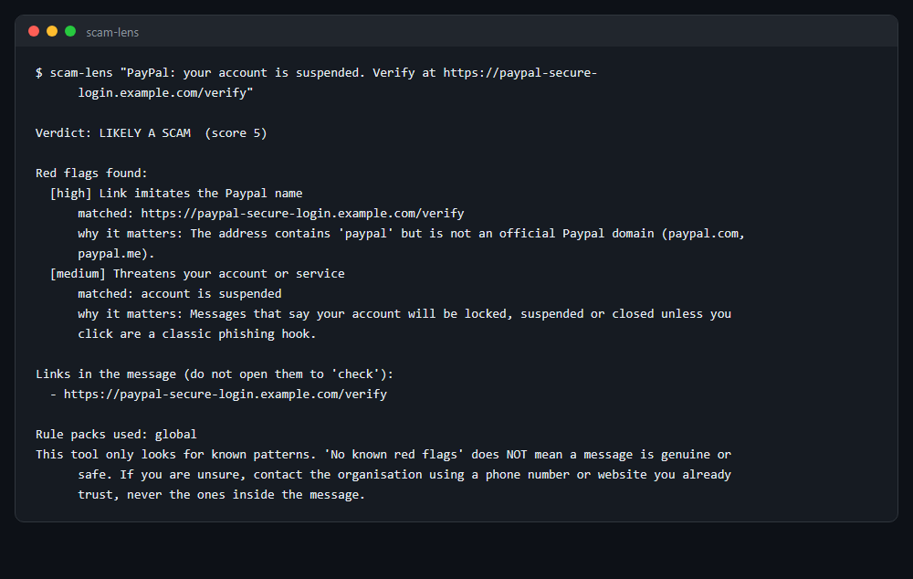
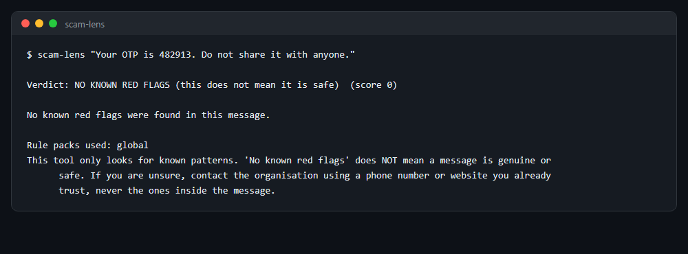

# scam-lens — check if a text message or email is a scam (offline)

[](https://github.com/SQasimHamdani/scam-lens/actions/workflows/ci.yml)
[](LICENSE)


**scam-lens explains, in plain language, why a message looks like a scam.** Paste an SMS, WhatsApp
message or email and get a list of the specific red flags it contains, such as pressure to act,
requests for a code or password, look-alike links and fake delivery fees. It runs entirely on
your own computer. Your messages are never sent anywhere.

## See it in action

**A typical scam text**: pressure, a code request and a hidden link, each explained:



**A look-alike link**: the message names a real brand but the link goes somewhere else:



**A genuine notice is left alone**: warnings such as "Do not share it with anyone" are not mistaken for requests. Even then the answer is *no known red flags*, never "safe":



## Vision

Scam messages are written to make people panic and click. Most people who fall for them are not
careless; they simply had no one to ask in that moment, and most "scam checkers" just return a
percentage or a yes/no with no reasoning, or send your private messages to a server.

scam-lens aims to be the knowledgeable friend you can ask: *"Is this a scam, and why?"*

What good looks like:
- **Explains, not just scores.** Every red flag comes with the matching text and a one-sentence reason.
- **Private by design.** No network calls, no accounts, no telemetry.
- **Honest about its limits.** It never says a message is "safe". Its best answer is
  *"no known red flags"*, because scammers keep inventing new tricks.
- **Local knowledge matters.** Scams differ by country. Rules live in small, readable JSON *rule
  packs* that anyone can read, review and improve, with regional packs maintained by people who
  know those scams.

What it will not do: detect every scam, replace your bank's or the police's advice, or open or
visit the links it finds.

## Quick start

```bash
pip install git+https://github.com/SQasimHamdani/scam-lens.git
scam-lens "URGENT: your bank account is suspended. Verify now at http://bit.ly/x9 and reply with your OTP."
```

```
Verdict: LIKELY A SCAM  (score 7)

Red flags found:
  [high] Asks you to share a code, PIN or password
      matched: reply with your OTP
      why it matters: No genuine bank, wallet or service will ask you to send or read out a
      one-time code, PIN, password or card security code.
  [medium] Threatens your account or service
      matched: account is suspended
  [low] Uses a link shortener
      matched: http://bit.ly/x9
  [low] Pressure to act quickly
      matched: URGENT
...
```

## Usage

```bash
scam-lens "message text"            # check a message
scam-lens --file message.txt        # read from a file
echo "message text" | scam-lens     # read from stdin
scam-lens --json "message text"     # machine-readable output
scam-lens -p global -p pk "..."     # combine rule packs (global + a regional pack)
scam-lens --pack-file mypack.json "..."   # use your own rule pack
scam-lens --list-packs
```

Exit codes make it easy to script: `0` no known red flags, `1` suspicious, `2` likely a scam,
`64` bad input.

As a library:

```python
from scam_lens import analyze, load_pack

report = analyze("You have won a prize! Claim now: http://bit.ly/abc", [load_pack("global")])
print(report.verdict, report.score)
for finding in report.findings:
    print(finding.severity, finding.title, "->", finding.evidence)
```

## What it checks

- **Wording:** urgency, account-suspension threats, requests for OTP/PIN/password, prize and
  lottery claims, gift-card/crypto payment demands, fake delivery fees, arrest and legal threats,
  "guaranteed returns", secrecy requests, "Hi Mum, new number" impersonation, remote-access apps.
  Phrases such as *"Do not share your OTP"* are recognised as warnings, not requests.
- **Links:** shorteners, raw IP addresses, look-alike (punycode) domains, the `user@host` trick,
  heavily abused domain endings, and links that imitate or contradict a brand named in the message.
- **Rule packs:** `global` (worldwide) and `pk` (a starter pack for scam patterns commonly
  reported in Pakistan). More regional packs are welcome.

How the verdict works: each red flag has a weight (low 1, medium 2, high 3) and each rule counts
once. A score of 0 is *no known red flags*, 1–2 is *suspicious*, 3 or more is *likely a scam*.
These thresholds are simple on purpose and are open to discussion in the issues.

## Privacy

Everything runs locally using only the Python standard library. scam-lens does not open links,
resolve domains or contact any server. Please remove personal details (names, account numbers)
before posting examples in issues.

## Contributing

The most valuable contributions are **new or improved rules**, especially for your country or
language, and **real examples of messages that were missed or wrongly flagged** (with personal
details removed). See [CONTRIBUTING.md](CONTRIBUTING.md) for how to add a rule pack entry.

## Roadmap

- [ ] More regional packs and languages (contributions welcome)
- [ ] Better handling of overlapping rules so related flags do not double count
- [ ] Email header checks (mismatched reply-to and sender)
- [ ] Optional simple web page that runs fully in the browser
- [ ] Publish to PyPI

## Limitations

scam-lens only recognises patterns it has been taught, and wording tricks or other languages can
slip past it. It is a helper for your judgement, not a security guarantee. If you think you have
been scammed, contact your bank and your local authorities right away.

## License

[MIT](LICENSE) © 2026 Syed Qasim Hamdani
